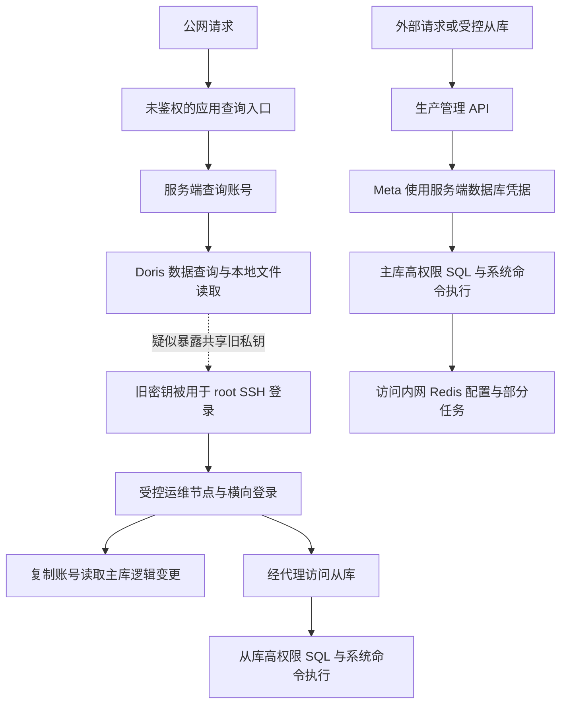

一次数据库 I/O 告警，最初看起来只是慢查询或连接堆积。沿着活跃会话、系统进程和网关日志追下去，却发现它连接着另一件事：公网查询接口被滥用，服务器文件被读取，共享 SSH 密钥被用于横向登录，数据库的复制与系统程序执行能力也进入了攻击链。

这次复盘最有价值的地方，是把几种容易混淆的判断拆开：**请求失败，不代表此前没有执行；账号不能 SELECT，不代表没有其他取数能力；没有发现输出文件，也不代表数据没有返回给调用者。**

<!-- truncate -->

> 本文依据脱敏调查笔记整理。事件事实及“已确认”等证据等级沿用笔记中的记录，本次整理未重新获取线上原始证据。公开版进一步省略了精确钟点、主机数量、业务规模、人员信息、内部定位和处置配置，仅保留阶段顺序、必要量级与技术关系。文章日期是整理日期，不代表事件日期；产品文档用于解释机制，不代替现场证据。

## 先划清证据边界

原笔记记录了多台主机的异常 `root` SSH 成功认证，也记录了主从数据库上以操作系统 `postgres` 身份执行命令的证据。部分查询结果已经保存在受控节点；另一些分支只有网络流量或返回行数，缺少完整正文。

管理员密码与管理 API Key 的最初来源、从受控节点继续向外部传输的完整范围，以及全部受影响用户的并集，仍有证据缺口。不能为了让故事完整，把这些空白补成一条确定的路径。

| 证据等级 | 本文如何使用 | 例子 |
|---|---|---|
| 已确认 | 有日志、命令结果或返回正文支持 | SSH 成功认证；逻辑变更结果已经落盘 |
| 强关联 | 多个独立特征吻合，但缺少关键正文或唯一关联标识 | 文件读取与随后使用旧密钥登录的关联 |
| 待验证 | 技术上可能，但尚未串起读取到使用的过程 | 某次大响应是否包含管理员密码 |
| 排除当前归因 | 已有证据支持正常操作或原判断不成立 | 经人员核对的运维登录和报表任务 |

“没有找到”也要写明范围。当前配置不是完整历史，文件修改时间不是不可抵赖的操作记录，关键词命中不是有效凭据清单。

## 攻击链跨过了哪些边界

下图合并了同类节点，不表示真实主机数量和完整网络拓扑。虚线表示关键环节仍缺直接证据。



这里有四种身份：HTTP 请求者、应用使用的数据库角色、数据库服务的操作系统用户，以及 SSH 登录用户。某个客户端以 `root` 运行，不代表远端数据库也获得了 `root` 权限。

按阶段看，调查还原出的顺序是：

| 阶段 | 主要观察 | 判断边界 |
|---|---|---|
| 入口探测 | 枚举接口、读取公开前端资源、尝试管理入口 | 找到用户名或路径，不等于拿到密码 |
| 未授权查询 | HTTP 请求与数据库审计对应，出现实际返回 | 查询能力被调用已经成立 |
| 文件读取与横向登录 | 读取敏感目录文件，随后出现旧密钥认证和跨节点登录 | 登录已确认；私钥取得路径为强关联 |
| 多路数据库访问 | 普通查询、复制取数、代理连接和管理 API 并行出现 | 每条路线分别核对身份、权限和结果 |
| 故障与处置 | 数据库派生系统程序，出现 I/O 异常并终止部分后端 | 终止一批进程不代表其他分支停止 |
| 后续复核 | 核对正常运维、凭据轮换、入口停用与残留 | 处置记录不能自动证明整套环境恢复可信 |

## 入口失守：应用替陌生请求使用了自己的权限

### 服务端没有验证请求者

查询接口的基本链路是：接收问题，生成或规划 SQL，检查“只读”，使用服务器配置的数据库账号执行，再把结果返回。

下面是原逻辑的删减改名版，用来说明缺陷，不是可部署的完整代码：

```ts
export async function POST(request: Request) {
  const input = await request.json();
  const result = await runQueryAssistant({
    question: String(input.question || "").trim(),
    requesterId: input.requesterId, // 客户端声明，不是可信身份。
  });
  return Response.json({ result });
}
```

关键问题发生在执行查询之前：**没有可信登录态，也没有对数据集和操作做授权。** 请求者不必先取得数据库密码，应用已经会替它连接数据库。

这类问题应按未授权调用查询服务分析。没有相应证据时，不应直接写成“SQL 注入”。原笔记还发现，另一个入口具备成员校验，但 HTTP 入口没有复用它；一个入口的检查无法覆盖另一个入口。

修复时应把身份与授权放到所有敏感操作的服务端入口。以下辅助函数需要按真实系统实现：

```ts
export async function POST(request: Request) {
  const principal = await authenticateServerSession(request);
  if (!principal) return new Response("Unauthorized", { status: 401 });

  const input = await parseAllowedQueryInput(request);
  if (!await canRunTemplate(principal, input.templateId)) {
    return new Response("Forbidden", { status: 403 });
  }
  return runApprovedQuery({
    principal,
    templateId: input.templateId,
    parameters: input.parameters,
  });
}
```

模板及其允许访问的数据对象由服务端控制，值参数化。隐藏按钮、CORS、前端登录页和请求体里的用户 ID 都不能代替授权。可对照 [OWASP 授权检查指南](https://cheatsheetseries.owasp.org/cheatsheets/Authorization_Cheat_Sheet.html)逐个检查入口。

### “只允许 SELECT”没有限制读取对象

原实现使用 SQL 字符串黑名单阻止部分写操作，再增加 `LIMIT`。它没有解决“能访问哪些表、列、函数和文件”的问题。

本案记录了通过 Doris `LOCAL` 表函数读取 BE 节点文件的事实。当前 [Doris 4.x LOCAL 文档](https://doris.apache.org/docs/4.x/sql-manual/sql-functions/table-valued-functions/local/)列出了管理员权限与安全目录要求；这些要求应结合实际版本和部署核对，不能反推出事发环境当时具备哪些限制。

`LIMIT` 约束结果行数，不保证扫描代价小，更不能让少量私钥或令牌变成安全数据。真正需要收窄的是查询账号、允许的数据对象、函数能力与服务进程的文件权限。

### 按输出列名脱敏，丢失了字段来源

另一层保护按 `password`、`token` 等输出列名隐藏值。但当调用者能控制表达式与别名时，列名已经不能代表内容来源。

下面仅使用虚构常量：

```sql
SELECT 'DEMO_ONLY' AS token;
SELECT HEX('DEMO_ONLY') AS h;
```

第一条可能被列名规则遮盖，第二条输出普通别名，而 HEX 仍可逆。把一整行 JSON 或文件内容放进普通字符串列，也会遇到相同问题。

原笔记保存的部分结果能够还原业务令牌，说明这层保护实际被绕过；另一些带 Key 字样的值只是配置引用名称，不能统统计为有效密钥。安全视图、预定义查询和数据库最小权限应先限制可读范围，输出脱敏作为补充。

## 从文件读取到主机控制：哪些已经证实

私钥来源的推断依赖几组独立线索：敏感目录中的 PEM 被读取；返回行数与字节数和留存旧密钥相符；随后外部来源使用对应指纹成功登录；受控节点继续用同一密钥登录其他主机。

这些线索支持“共享私钥经文件读取暴露”，但最关键那次返回正文未保存，仍应标为强关联。公开文章无需保留 PEM 大小、精确间隔或指纹，也能讲清这个判断过程。

调查还确认，复核时相关 BE 进程以 UID 0 运行。它与此前读取 root 目录文件的证据共同说明部署权限放大了影响，但当前状态本身不等于完整历史。

检查实际进程身份可先用：

```bash
sudo ps -C doris_be -o pid,ppid,user,comm
```

进程名或容器环境不同，需要先找到真实 PID。默认不输出完整参数和环境变量，避免把连接串或凭据带进报告。

降权可以收敛影响，但服务账号通常仍能读取自身配置。移除不必要的私钥副本、撤销跨主机共享授权、限制查询能力，需要一起做。

## 数据库里的几条路线，要分开判断

### 普通 SELECT 失败，复制取数仍然可能成立

主库日志中，复制账号的部分普通查询和文件读取被拒绝。但另有复制槽创建、读取以及结果落盘的证据，证明数据经另一种能力到达受控节点。

不能把这件事简化成“复制角色等于超级用户”，也不能把普通查询、原始槽解码和内置发布订阅混为一谈。需要核对角色、输出插件、槽、读取机制与初始同步权限。[PostgreSQL 逻辑复制安全说明](https://www.postgresql.org/docs/15/logical-replication-security.html)

此外，`peek_changes` 不推进槽的消费位置，重复读取可能重复返回。变更记录数也不是用户数。[PostgreSQL 复制管理函数](https://www.postgresql.org/docs/15/functions-admin.html#FUNCTIONS-REPLICATION)

### localhost 可能只是代理的下一跳

从库存在“受控节点 → TCP 代理 → 数据库本地端口”的连接链。因此数据库看到 localhost，不代表操作者就在本机，更不代表它是正常运维。

| 日志观察 | 可以说明什么 | 不能单独推出什么 |
|---|---|---|
| TCP stream 状态 200 | 代理层连接处理状态 | HTTP 成功或数据库密码正确 |
| HBA 拒绝 | 连接未通过相应访问控制 | 密码已被验证正确 |
| 已认证会话中的权限不足 | 身份已进入数据库，某项操作被拒绝 | 其他查询或复制能力也被阻止 |
| HTTP 200 | HTTP 层返回成功状态 | 所有 SQL 成功、凭据来源已查清 |

必须先明确状态码属于哪一层，再解释它的意义。

### 管理 API 借助受信任服务器连接主库

另一条路线经生产管理 API 进入 Meta，再由 Meta 使用服务端数据库凭据连接主库。这与从外部直接拿数据库密码登录，是两件不同的事。

能调用管理 API，不自动证明调用者知道数据库密码；直连被 HBA 拒绝，也不能证明它无法经管理 API 操作数据库。本案关于管理员密码已被掌握的判断，来自另一份留存脚本，不能反过来假定管理接口曾返回密码。

Kong 的 Key Auth 与 ACL 分别承担凭据认证和访问组限制。核查时应确认请求经过哪些路由、Consumer 与组的关系，以及事发时真正生效的配置；不能只凭 401、403、200 的变化宣布产品存在已利用漏洞。[Kong Key Auth](https://developer.konghq.com/plugins/key-auth/)、[Kong ACL](https://developer.konghq.com/plugins/acl/)

### COPY 报错，程序也可能已经执行

原笔记保存的进程关系可概括为：

```text
postgres
└─ shell
   └─ 文件搜索与结果截取程序
```

PostgreSQL 的 `COPY ... PROGRAM` 是高权限的服务端功能，执行身份是数据库服务的操作系统用户。它需要超级用户或相应的 `pg_execute_server_program` 权限，不是普通查询默认具备的能力。[PostgreSQL COPY 文档](https://www.postgresql.org/docs/15/sql-copy.html)

本案中程序先产生输出，随后 COPY 解析报错。进程树、子进程和终止日志共同支持“命令已经启动”。SQL 最终失败不会撤销先前发生的系统操作；与此同时，OS `postgres` 执行也不能写成数据库主机已被提权到 `root`。

## 从 I/O 告警往回查：取证顺序比关键词更重要

### 先把活跃会话对到进程

连接总数和 idle 数量不能直接解释负载。优先查看查询持续时间、事务持续时间、等待事件和后端 PID。下面是元数据查询示意，不输出 SQL 正文；账户和地址仍属于内部调查信息。

```sql
BEGIN READ ONLY;
SET LOCAL statement_timeout = '5s';
SET LOCAL lock_timeout = '1s';

SELECT pid, usename, application_name, client_addr, state,
       clock_timestamp() - query_start AS query_age,
       clock_timestamp() - xact_start AS transaction_age,
       wait_event_type, wait_event
FROM pg_stat_activity
WHERE pid <> pg_backend_pid()
  AND (state = 'active' OR state LIKE 'idle in transaction%')
ORDER BY query_start NULLS LAST
LIMIT 100;

ROLLBACK;
```

用实际后端 PID 再查 `ps`、进程树及可执行文件路径。尽量先采集命令名，完整参数和语句保存在受限证据区。`pg_stat_activity` 展示活动状态，不是历史审计；权限也会影响可见内容。[PostgreSQL 活动视图](https://www.postgresql.org/docs/15/monitoring-stats.html#MONITORING-PG-STAT-ACTIVITY-VIEW)

### 确认日志实际落在哪里

`logging_collector=off`、`pg_current_logfile()` 为空，不等于没有 PostgreSQL 日志。服务管理器、容器或启动重定向仍可能收集 stderr；本案就在发行版管理的日志文件中找到后续证据。

核对日志设置后，再查服务启动方式和进程 stderr 去向。分析完整日志副本，保留同一 PID 附近跨行的 SQL、DETAIL 和 CONTEXT。未记录的成功语句无法靠事后调高日志级别补回来。[PostgreSQL 日志配置](https://www.postgresql.org/docs/15/runtime-config-logging.html)

### 再把数据库、网关和应用串起来

数据库记录的来源是应用服务器，不能直接推出应用服务器已被 SSH 控制。沿该地址继续核对 Nginx、网关与 Meta 日志，比较时间、请求 ID、数据库后端和错误模式。

有共同 ID 的记录可以更精确关联；只有时间和错误相似的，应保留“强关联”。对历史时钟偏差没有测量时，毫秒级文件时间也不能补足缺失的执行审计。

容器检查优先限定启动时间、重启次数、日志驱动和端口等元数据。完整 `docker inspect`、环境变量和原始请求头可能包含密码或 Key，不应直接复制到公开材料。

### SSH 成功、失败和正常运维分别统计

`Invalid user`、`preauth` 断开和无效协议 banner 都不是成功认证。应查找 `Accepted publickey` 或 `Accepted password`，再核对来源、用户、指纹和会话记录。

成功认证证明某个身份通过了认证，不能独立识别自然人。原笔记中有一批新密钥登录，经人员核对属于正常维护，已从攻击统计中移除。没有逐条时间戳的 shell history，也不能强行归入某个 SSH 会话。

### 留存文件要同时看版本与结果

可疑脚本先静态阅读，不重跑，也不用其中的凭据测试线上系统。脚本内容能说明计划行为，目标日志和输出才支持实际执行。

本案有同名脚本后来被覆盖的情况。最后留存的文件不能代表更早执行的版本，需要一起核对日志中的语句、保存时间和内容哈希。文件属主也不是创建者的充分证据。

部分 SQL 没有设置本地输出文件，结果可能经 SSH stdout 返回。因此，“本机没有找到结果文件”不能排除数据已经被调用方接收。

## 影响统计：正文、流量与人数不能相加

公开版只保留说明判断所必需的量级，不复现能够关联具体事件的精确数字。

| 材料 | 原笔记支持的结论 | 不应扩大成 |
|---|---|---|
| 主库逻辑变更正文 | 数万条变更、数十 MB 结果到达受控节点 | 同等数量的用户，或已经全部外传 |
| 从库 TCP 回传记录 | 有数十 MB 级协议流量，部分大响应缺正文 | 等量业务数据或确定的管理员凭据泄露 |
| 账户、令牌与会话记录 | 需要按用户、会话、令牌分别去重 | 将几个分类的人数直接相加 |
| 密码哈希 | 哈希材料已暴露 | 明文密码已取得或账号已被盗用 |
| 表计数与扫描计数 | 反映表规模或累计处理次数 | 已导出相同行数或独立键值数量 |
| 备份残片或解析器计数 | 存在部分材料或处理量记录 | 完整备份已经取得 |

**结果文本大小与网络协议流量不能相加成“总泄露量”。** 后者可能包含错误、协议开销和重复内容，前者也可能来自重复读取。

逻辑变更里的 INSERT、UPDATE、DELETE 是被捕获的业务变更类型，不能直接当成攻击者执行了同等数量的篡改。人员确认的正常报表任务也应先排除，再计算异常取数。

对凭据来源，应比较“同一个秘密值”，不要只比较字段名称。受限环境中只输出字段代号和匹配布尔值；密码不要作为命令行参数，也不要拼进会被审计的 SQL。现存配置没有匹配结果，只能说明本次检查范围内没有命中，不能排除历史配置变化。

## 修复要覆盖每一层权限

| 边界 | 需要落实的控制 | 如何验证 |
|---|---|---|
| HTTP 与业务对象 | 所有敏感入口统一认证，按服务端身份授权 | 未登录、低权限、跨对象请求均有对应检查 |
| 查询能力 | 预定义数据集、受控模板、值参数化、数据库最小权限 | 应用账号不能读取授权范围外的数据和文件 |
| 服务进程 | 专用低权限用户、文件隔离、移除不必要凭据副本 | 检查实际 UID、可读目录与配置权限 |
| SSH | 撤销旧授权，减少共享密钥，限制入口与来源 | 核对各节点、模板和自动化是否仍恢复旧授权 |
| 数据库高权限 | 分离应用、复制、管理身份，收回多余程序执行权限 | 分别审计角色、复制槽、插件与管理 API |
| 内网服务 | 网络访问控制与业务 ACL 同时落实 | 验证未授权连接及命令、键范围的限制 |
| 日志与采集 | 控制证据权限、保留范围和秘密输出 | 不因 `set -x`、环境转储或错误日志再次泄露 |

内网 Redis 是另一个独立例子：原笔记保存了无需 AUTH 即可读取配置和部分任务的结果。个别受保护配置拒绝修改，不代表其他读取也受到了保护。ACL 可以按用户限制命令及键范围，需要结合网络控制核对。[Redis ACL 文档](https://redis.io/docs/latest/operate/oss_and_stack/management/security/acl/)

调查还发现初始化脚本下载校验不足、临时令牌进入日志，以及业务 Socket 先订阅再授权等问题。这些问题值得修复，但不能因此宣布它们全部被用于本次入侵。没有版本条件与利用证据，也不应把事件归因于某个产品 CVE。

原笔记记录了入口限制、凭据轮换和部分进程处置等措施，尚不足以证明所有受控主机恢复可信。后续需要补齐持久化排查、凭据副本撤销、云控制面审计与恢复验收；需要时从可信来源重建。

## 三个可以复用的离线脚本

把完整代码放在下载文件里，正文保留用途和边界。三个脚本均使用 Python 3 标准库，只读取明确指定的本地文件，不联网、不连接数据库、不执行样本。它们是整理后的分析工具，不是原始攻击脚本，也不附带事件日志。

| 工具 | 输入与用途 | 下载 |
|---|---|---|
| Nginx 统计 | combined access log 或 `.gz`；统计状态码、方法、来源代号和固定路径分类 | <a href="/downloads/incident-analysis/nginx_summary.py" download="nginx_summary.py">nginx_summary.py</a> |
| SSH 成功认证统计 | auth 日志或 `.gz`；聚合 Accepted 记录，替换来源、非 root 用户和指纹 | <a href="/downloads/incident-analysis/ssh_summary.py" download="ssh_summary.py">ssh_summary.py</a> |
| 归档静态清点 | tar 及支持的压缩格式；统计成员类型、逻辑大小和可疑路径 | <a href="/downloads/incident-analysis/archive_inventory.py" download="archive_inventory.py">archive_inventory.py</a> |

下载到当前目录后，可对本地证据副本运行，以下文件名均为示例：

```bash
python3 nginx_summary.py evidence/access.log evidence/access.log.1.gz
python3 ssh_summary.py evidence/auth.log evidence/auth.log.1.gz
python3 archive_inventory.py evidence/sample.tar.gz --max-members 10000
```

公开版对日志工具做了两项输出收敛：默认省略绝对日期和小时；Nginx 方法字段只保留标准方法名，其他值统一归类，避免异常原始字段进入报告。仅在内部关联确实需要时添加 `--include-times`；此时输出会包含真实日志时间，不应直接公开。

Nginx 工具还支持带时区的 `--since` 和 `--until`，按左闭右开的区间过滤。SSH 工具不会猜测缺失的年份和时区，这类记录会计入时间质量统计，但不进入 UTC 小时分布。

使用结果时仍要注意：

- 来源代号只在一次运行内有效，两个工具里的 `SOURCE_001` 不保证是同一来源；真实客户端 IP 还取决于可信代理配置。
- 重复行、重叠轮转文件不会自动去重。读取完成不代表每行都解析成功，要一起看解析失败和未匹配计数。
- UA 只是自动化特征提示，Accepted 也不能独立判断操作者。脚本不是攻击归因工具。
- 归档工具不提取成员、不输出成员名和正文。成员上限不等于解压字节或耗时上限；元数据遍历也不是完整归档校验或安全解压保证。
- 统计结果仍包含精确计数和分组关系。对外分享前需要再检查业务规模与组合识别风险，不能把“使用代号”当成自动匿名化。

采集器本身也需要设定单文件、总量、空闲空间与超时限制，并记录跳过、截断和采集过程中文件变化。“只读”通常是指不修改业务数据，采集仍会写证据副本并消耗资源；哈希用于验证保存内容的一致性，不能证明已失陷主机上的日志从未被修改。

## 让下一次告警能留下更好的证据

值得持续观察的信号包括：管理路径连续失败后出现成功、异常复制槽创建、数据库派生 shell、同一 SSH 密钥短时间跨节点认证，以及服务身份访问不属于其职责的数据。

这些信号都需要正常任务清单和跨层关联字段。只有 IP、UA 或一个状态码时，容易把自动化任务和调查人员自己的操作算进去。

这次复盘留下的核心问题始终是：**谁通过哪个入口，借用了什么身份，执行了什么能力，结果到达了哪里。** 能回答这些问题，才能准确划定影响，也才能知道某项修复究竟切断了攻击链的哪一段。
