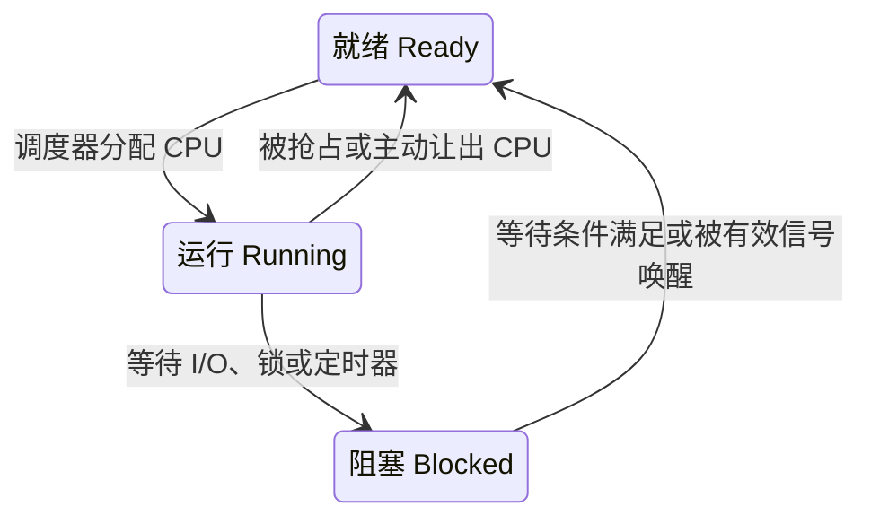

# Linux 进程调度与系统状态

操作系统让多个任务共享 CPU 和内存：任务能运行时参与调度，等待某个事件时可以让出 CPU，结束后由内核和父进程完成资源清理。理解这个过程，才能正确解读 `free`、`ps` 和 `top`，区分“CPU 忙”“任务在等待”和“内存紧张”。

本文以 Linux 与 Bash 为例。讲解调度时常用“进程”帮助理解；更准确地说，Linux 调度的是**线程这样的可调度任务**，同一个进程中的多个线程可以分别运行、就绪或阻塞。

## 一、free -h 各字段的含义

`free -h` 查看物理内存与交换空间，`-h` 表示自动使用便于阅读的单位，如 `Mi`、`Gi`，默认按 1024 进位。

```text
               total        used        free      shared  buff/cache   available
Mem:             ...         ...         ...         ...         ...         ...
Swap:            ...         ...         ...
```

| 字段 | 含义 |
|---|---|
| `Mem` | 系统可用的物理内存统计，已扣除部分保留区域 |
| `Swap` | 交换空间统计，通常由交换分区或交换文件提供，也可能使用 zram |
| `total` | 物理内存或交换空间的总量 |
| `used` | 已使用或不可用的量；当前 procps-ng 中，内存按 `total - available` 计算，交换空间按 `total - free` 计算 |
| `free` | 当前完全未使用的量；内存对应 `/proc/meminfo` 中的 `MemFree` |
| `shared` | 主要是 tmpfs 等使用的共享内存，对应 `Shmem`；不等于所有进程共享内存的简单总和 |
| `buff/cache` | 内核缓冲区、页缓存和可回收 slab 等占用的内存，包含 `Buffers + Cached + SReclaimable` |
| `available` | 估计不发生交换即可供新应用使用的物理内存，考虑了空闲内存及可回收缓存等因素 |

**判断内存余量优先看 `available`，不能只看 `free`。** Linux 会利用内存缓存数据，`free` 很小不一定意味着内存不足；`buff/cache` 也不是全部都能立即回收。`shared`、`buff/cache`、`available` 并非互不重叠的分区，不能把所有列直接相加。参见 [free 手册](https://man7.org/linux/man-pages/man1/free.1.html)。

旧版 procps-ng 的 `used` 常按 `total - free - buffers - cache` 计算，所以不同机器上的公式可能不同。可用 `free --version` 和本机 `man free` 确认，旧口径见 [procps-ng v3.3.17](https://github.com/procps-ng/procps/blob/v3.3.17/free.1)。

## 二、程序、进程与多道技术

### 程序与进程

**程序**是描述如何完成任务的指令和数据，通常以可执行文件、脚本等形式保存。**进程**是程序的一次执行实例，包含地址空间、打开的文件、身份信息以及执行状态等。同一个程序可以对应多个进程，例如同时启动两次 `sleep 10`。

进程存在不代表它此刻正在使用 CPU：它可能正在计算，也可能在等待输入或等待调度。程序与进程的区别、CPU 时间共享的基本思路，参见 [OSTEP 进程章节](https://pages.cs.wisc.edu/~remzi/OSTEP/cpu-intro.pdf)。

### 多道技术产生的背景

早期单道运行方式一次只处理一个作业。当该作业等待较慢的外设或人工输入时，CPU 可能无事可做。多道程序设计允许多个作业共同驻留内存：一个任务等待时，CPU 可以执行另一个已准备好的任务，从而提高 CPU 利用率和系统吞吐量。

例如，任务 A 发出磁盘读取请求后阻塞，磁盘继续处理请求，CPU 转去执行任务 B。收益来自**把 A 的等待时间与 B 的计算时间重叠**，不是因为任务切换本身能加快计算。

### 多道技术的核心构成

| 构成 | 作用 |
|---|---|
| 空间复用 | 多个任务共同使用内存等资源；内存管理和保护机制隔离各任务，防止任意相互覆盖 |
| 时间复用 | 多个任务轮流使用 CPU；调度器选择任务，并保存、恢复执行上下文 |

中断、调度、内存保护和资源管理共同支持这些机制。多道程序设计主要解决资源利用问题；分时与抢占调度进一步改善交互响应和公平性，不能把多道技术仅理解成“时间片到了就换人”。

### 多个核如何应用多道技术

每个逻辑 CPU 都可以调度不同任务；同一个逻辑 CPU 上的任务交替执行，不同逻辑 CPU 上的任务可以同时执行。调度器还会考虑负载均衡、CPU 亲和性等因素。

```text
时间 →
逻辑 CPU 0： A → B → A → B
逻辑 CPU 1： C → D → C → D
```

因此，多核系统中可以同时存在并发与并行。单线程程序不会因为机器有多个核，就自动同时占用多个核执行；程序需要有可并行的多个进程或线程。调度单位与策略见 [sched 手册](https://man7.org/linux/man-pages/man7/sched.7.html)。

## 三、区分三组容易混淆的概念

### 串行、并发与并行

| 概念 | 关注点 | 例子 |
|---|---|---|
| 串行 | 任务依次完成，执行时间不重叠 | A 完成后才启动 B |
| 并发 | 多个任务在同一段时间内推进 | 单个逻辑 CPU 在 A、B 之间切换 |
| 并行 | 多个任务在同一时刻实际执行 | A、B 分别在两个 CPU 核上运行 |

并发不要求每个瞬间都同时执行，也不只是视觉上的“看起来同时”。入门时可记为“单核能并发，多核能并行”；严格讨论 CPU 任务时，应区分物理核与逻辑 CPU。SMT／超线程能让一个物理核提供多个硬件线程，但这些线程共享执行资源，不能把它们当成完全独立的物理核。

### 同步与异步

这里讨论调用与任务完成的关系，不是“线程同步”中的锁或互斥。

- **同步调用**：调用方在本次调用中等待操作完成、得到结果或错误，再继续后续逻辑。
- **异步调用**：先提交操作，本次调用返回时操作可能尚未完成；完成后通过回调、事件、结果对象或查询取得结果。

“同步”描述某次调用的关系，不代表整个系统只能串行运行。两个线程分别执行同步调用，仍可以并发。异步任务也可能在队列中依次执行，不保证并行。异步 I/O 的提交与完成通知机制可参见 [aio 手册](https://man7.org/linux/man-pages/man7/aio.7.html)。

### 阻塞与非阻塞

这组术语通常描述**调用在暂时不能完成时的行为**；阻塞调用等待时，会使调用线程进入等待状态。不能简单地给整个程序贴上永久“阻塞”或“非阻塞”的标签。

- **阻塞**：条件尚未满足时，调用线程睡眠等待，不继续执行后续代码，也不占用 CPU 空转。
- **非阻塞**：条件尚未满足时立即返回，调用方自行决定下一步；例如非阻塞 socket 读取无数据时，返回 `EAGAIN` 或 `EWOULDBLOCK`。

**非阻塞返回不代表操作已经成功，也不等于异步完成。** 反复轮询非阻塞接口仍可能消耗大量 CPU。`read` 的返回值和错误语义见 [read 手册](https://man7.org/linux/man-pages/man2/read.2.html)。

| 场景 | 是否可能阻塞 |
|---|---|
| 磁盘 I/O | 可能；数据命中缓存且无其他等待时，不一定需要等待设备 |
| 网络 I/O | 可能；取决于接口模式、缓冲区数据和网络情况 |
| `sleep` | 会等待时间到期，通常不消耗 CPU；它是定时等待，不是 I/O |
| Bash `read` | 从终端读取而输入尚未准备好时通常会等待；输入已就绪或到达 EOF 时可能直接返回 |
| 等待锁、条件变量或子进程 | 条件尚未满足时可能阻塞 |

### Bash 中的后台符号 &

```bash
# 串行：通常约 4 秒
sleep 2
sleep 2

# 并发等待：通常约 2 秒
sleep 2 &
first_pid=$!
sleep 2 &
second_pid=$!
wait "$first_pid" "$second_pid"
```

`&` 让 shell 异步启动命令，不等待它结束便继续；`$!` 保存最近一个后台任务的 PID，`wait` 等待指定任务。两个 `sleep` 主要在睡眠，不能用这个例子证明 CPU 并行计算。后台运行也不等于成为守护进程或关闭终端后一定继续运行。参见 [Bash 手册](https://man7.org/linux/man-pages/man1/bash.1.html)。

## 四、CPU 何时切换任务

切换时，操作系统保存当前任务的寄存器、指令位置等上下文，并恢复另一个任务的上下文，使它能够接着运行。

| 触发情况 | 状态变化 | 对效率和响应的影响 |
|---|---|---|
| 当前任务等待 I/O、锁、输入或定时器 | 运行 → 阻塞 | 有其他就绪任务时，可利用这段等待时间提高总体利用率；切换仍有成本 |
| 运行预算用完、时间片到期，或调度器决定让其他任务运行 | 运行 → 就绪 | 改善公平性和响应；纯计算任务过于频繁地切换会增加开销 |
| 更高调度优先级的任务变为可运行，并触发抢占 | 运行 → 就绪 | 改善高优先级任务的响应，但当前任务会延后执行 |
| 任务主动让出 CPU | 通常运行 → 就绪 | 是否有收益取决于策略和负载；没有其他合适任务时可能仍运行原任务 |
| 任务结束 | 运行 → 退出流程 | CPU 转去执行其他任务；没有就绪任务时进入空闲 |

这里的时间片是便于理解的概念，不同调度策略的规则不同；时钟中断也不保证每次都切换到其他任务。上下文切换会带来调度、保存恢复以及可能的缓存开销，不能概括成“切换总会提高效率”或“切换总会降低效率”。具体策略见 [sched 手册](https://man7.org/linux/man-pages/man7/sched.7.html)。

**进入内核态不等于切换进程。** 例如 `read()` 数据已就绪时，内核完成处理后可以直接返回原线程；发生中断也可能在处理完后继续执行原任务。

## 五、进程三态与 Linux 状态码

### 三态模型与转换原因



- **就绪**：具备执行条件，正在等待 CPU。
- **运行**：已经获得 CPU，正在执行指令。
- **阻塞**：缺少 CPU 之外的执行条件，暂时不能运行。

在这个简化模型中，阻塞解除先回到就绪，再经调度进入运行；就绪任务也不会直接进入阻塞，必须先执行到需要等待的位置。新建、暂停和退出属于更完整的状态模型，三态图没有全部展开。三态模型及转换见 [OSTEP 进程章节](https://pages.cs.wisc.edu/~remzi/OSTEP/cpu-intro.pdf)。

### ps 中的主状态

Linux 的 `R` 同时覆盖教材里的**运行和就绪**，所以看到 `R` 不能断言该任务此刻已经占有 CPU。

| 状态 | 含义 |
|---|---|
| `R` | 正在运行，或可运行并等待调度 |
| `S` | 可中断睡眠，等待事件完成，可被符合条件的信号唤醒 |
| `D` | 不可中断睡眠，常见于 I/O 或内核资源等待 |
| `I` | 空闲的内核线程 |
| `T` | 被作业控制信号暂停，例如通常按 `Ctrl+Z` 后的任务 |
| `t` | 调试跟踪中的暂停 |
| `Z` | 已终止但尚未回收的僵尸进程 |
| `X` | 已死亡的内部状态，正常情况下不应在 `ps` 中看到 |

### STAT 后缀

| 标记 | 含义 |
|---|---|
| `+` | 属于终端的前台进程组，不表示此刻一定正在使用 CPU |
| `s` | 会话首进程，PID 等于会话 ID；不表示“只负责接收请求，让子进程干活” |
| `l` | 多线程进程，小写字母 L |
| `<` | 高优先级 |
| `N` | 低优先级 |
| `L` | 存在锁定在内存中的页面，大写字母 L |

例如 `Ss` 是“可中断睡眠的会话首进程”，`R+` 是“处于运行／就绪状态且属于前台进程组”。主状态和后缀以 [ps 手册](https://man7.org/linux/man-pages/man1/ps.1.html#PROCESS_STATE_CODES) 为准。

### S 与 D 的信号行为

`S` 表示等待可被信号中断，不意味着任何信号都会终止进程。通常 `Ctrl+C` 向终端前台进程组发送 `SIGINT`，程序可以捕获或忽略它；`SIGKILL` 不能被捕获或忽略。

`D` 不能简单解释为“磁盘太忙”或“为了防止数据丢失而不能杀”。真正的不可中断等待需要内核先完成相应等待路径，`kill -9` 即使发送成功，也可能要等等待结束后才能使进程退出。内核另有可响应致命信号的 `TASK_KILLABLE` 等待，工具也可能将其显示为 `D`，因此不能断言所有 `D` 状态都永远无法终止。等待机制见 [Linux 内核等待队列文档](https://docs.kernel.org/driver-api/basics.html#wait-queues-and-wake-events)。

### 僵尸进程为何存在

子进程终止后，通常释放地址空间、关闭文件等，但保留 PID、退出状态和资源使用统计，供父进程调用 `wait()`／`waitpid()` 读取。未回收期间就是 `Z` 状态：不执行代码，但仍占少量内核记录和 PID 资源。

这是一种**传递退出信息的生命周期机制**，不宜只称为“优化机制”。也不是每个进程退出时都必须留下僵尸：显式将 `SIGCHLD` 设为 `SIG_IGN` 或使用 `SA_NOCLDWAIT`，可以避免留下僵尸状态。僵尸已经结束，`kill -9` 不能替代父进程回收；父进程退出后，由接管它的 subreaper 或 PID 1 负责回收。参见 [wait 手册](https://man7.org/linux/man-pages/man2/wait.2.html#NOTES)。

## 六、进程树与 PID 0、1、2

一般进程通过创建子进程形成父子关系，`PID` 是自身编号，`PPID` 是父进程编号。可以用下面的简图理解宿主 Linux 系统启动后的常见结构：

```text
PID 0：内核启动任务／空闲任务（特殊任务，普通 ps 通常看不到）
├── PID 1：init，常见实现为 systemd
│   ├── 系统服务
│   └── 登录服务 → shell → 用户命令
└── PID 2：kthreadd
    └── 许多内核线程
```

PID 0 是内核建立的特殊任务，不能当作普通用户进程；多处理器系统还存在各 CPU 的空闲任务。启动路径先建立 PID 1，再建立 `kthreadd`，见 [Linux 启动源码中的 rest_init](https://github.com/torvalds/linux/blob/master/init/main.c)。

PID 1 是常规用户进程树的重要根节点，PID 2 负责创建许多内核线程，但“所有用户态进程都来自 1、所有内核态进程都来自 2”过于绝对。**用户进程执行系统调用进入内核态，并不会变成 PID 2 的子进程。** 内核态是 CPU 执行权限状态，内核线程是任务类型。

容器的 PID 命名空间可以有自己的 PID 1，看到的 PID 和父子关系可能与宿主机不同。孤儿进程也可能先交给最近的 subreaper，而非直接交给宿主机的 PID 1。参见 [PID 命名空间手册](https://man7.org/linux/man-pages/man7/pid_namespaces.7.html)。

```bash
ps -eo pid,ppid,stat,comm --forest
# 安装了 psmisc 时，也可以使用：
pstree -p
```

## 七、管道是什么，为什么需要管道

进程通常拥有隔离的地址空间，不能随意读取另一个进程的内存。需要合作时，要使用操作系统提供的进程间通信机制。**管道是由内核管理的单向字节流通道**，提供读端、写端和缓冲区，使一个进程产生的数据能够流向另一个进程。

```bash
printf 'apple\nbanana\napple\n' | sort | uniq -c
```

数据流向为 `printf` 的标准输出 → `sort` 的标准输入，再由 `sort` 的标准输出 → `uniq` 的标准输入。Shell 的 `|` 负责建立这些连接，从而将多个小工具组合为处理流程；默认不包含标准错误输出。

管道各阶段可以并发存在，但实际何时输出由程序决定。例如 `sort` 通常要读完输入才能给出完整排序结果。

- 匿名管道通常由父进程创建，再通过继承文件描述符供相关进程使用。
- 命名管道 FIFO 有文件系统路径，允许具备权限的进程通过路径打开；路径不是保存管道数据的普通文件。
- 管道没有消息边界，也不能像普通文件一样任意定位读取。
- 阻塞模式下，空管道在仍有写端打开时，读操作会等待；缓冲区满时写操作可能等待。
- 所有写端关闭且数据读完后，读取返回 EOF；所有读端关闭后再写，通常触发 `SIGPIPE`，或在相应信号处理条件下返回 `EPIPE`。

管道使程序能够流式传递数据，并利用有限缓冲区协调生产和消费速度。它是进程间通信的一种方式，其他方式还包括 socket、共享内存等。语义见 [pipe 手册](https://man7.org/linux/man-pages/man7/pipe.7.html)。

## 八、top 中的平均负载与 CPU 利用率

### load average 的三个数

```text
load average: 3.00, 2.50, 1.80
```

三个值依次反映约 **1、5、15 分钟时间尺度**上的负载趋势，是平滑的平均值，不是三个瞬间的进程数。Linux 负载主要统计可运行任务（包括正在运行和排队的 `R`）以及计入负载的不可中断等待任务（通常为 `D`），统计单位可以是线程；普通 `S` 睡眠任务不计入。参见 [proc_loadavg 手册](https://man7.org/linux/man-pages/man5/proc_loadavg.5.html)。

因此，负载高可能是 CPU 需求多，也可能是大量任务等待 I/O。`load = 4` 不等于当前恰好有 4 个进程在运行，更不等于 CPU 利用率必然为 100%。

以 **4 个可用逻辑 CPU、任务主要消耗 CPU、没有明显 D 等待且负载分布较均衡** 为前提，可以作如下粗略判断：

| 平均负载 | 粗略含义 |
|---|---|
| 约 3 | 总体 CPU 需求低于 4 个逻辑 CPU 的并行容量 |
| 约 4 | 需求接近容量，仍不能证明每个 CPU 都满载 |
| 长期高于 4 | 可能存在持续排队，应检查具体任务和 CPU 使用情况 |

若任务绑在单个 CPU 上、容器有 CPU 配额、虚拟机资源受限或存在大量 D 等待，这种比较会失真。平均负载用于观察压力和趋势，不宜直接换算成 CPU 使用率。

### CPU 利用率字段

`top` 的 CPU 行描述采样间隔内的 CPU 时间分布。

| 字段 | 含义 |
|---|---|
| `us` | 普通用户态执行时间 |
| `sy` | 内核态执行时间 |
| `ni` | 调整过 nice 值的任务所消耗的用户态时间 |
| `id` | 空闲时间 |
| `wa` | I/O 等待相关的空闲时间统计，不是 CPU 正在执行 I/O 指令的时间 |
| `hi` | 硬件中断处理时间 |
| `si` | 软件中断处理时间 |
| `st` | 虚拟机本可运行、但被宿主机用于其他工作的 CPU 时间 |

按 `1` 可以展开各逻辑 CPU，按 `P` 按 CPU 使用率排序，按 `M` 按内存使用率排序。在常见的 Irix 计数模式下，进程的 `%CPU` 可以超过 100%，例如多个线程合计使用约两个逻辑 CPU 时可接近 200%；切换计数模式会改变显示口径。参见 [top 手册](https://man7.org/linux/man-pages/man1/top.1.html)。

不要只用 `100 - id` 表示“CPU 在做计算”，因为该值还可能包含 `wa`、`st` 等时间。`wa` 也不是磁盘利用率，尤其在多核系统上存在统计局限，应结合任务状态和设备指标判断。参见 [proc_stat 手册关于 iowait 的说明](https://man7.org/linux/man-pages/man5/proc_stat.5.html)。

### 一组排查命令

```bash
free -h
uptime
top
ps -eo pid,ppid,stat,ni,pcpu,pmem,wchan:24,comm --sort=-pcpu

# 查看线程，以免只看进程主线程而漏掉其他线程的状态
ps -eLo pid,tid,stat,pcpu,wchan:24,comm
```

`wchan` 可帮助定位任务正在等待的内核位置，显示内容受权限和内核配置影响。`ps` 的 `%CPU` 通常是任务存活期间的累计平均，不能直接与 `top` 最近一次采样的百分比逐项比较。

排查时先区分：是 `us/sy` 高且有任务排队，还是 CPU 较空闲但 D 等待增多；再结合内存 `available`、交换活动和具体任务定位问题。

## 九、今日测验速答

| 问题 | 答案要点 |
|---|---|
| `free -h` 的字段如何理解 | `total` 总量，`used` 已用或不可用，`free` 完全空闲，`shared` 主要为 tmpfs 共享内存，`buff/cache` 缓冲与缓存，`available` 估计可用量；注意版本口径 |
| 程序与进程有什么区别 | 程序是指令和数据；进程是执行实例，携带运行状态和资源 |
| 为什么产生多道技术 | 单个作业等待时 CPU 可能闲置，让其他就绪任务利用这段时间 |
| 多道技术的核心是什么 | 空间复用与时间复用，并配合隔离、调度和资源管理 |
| 多核上如何应用 | 同一逻辑 CPU 上交替执行，不同逻辑 CPU 上可以并行；可执行任务数超过 CPU 数时仍需轮流运行 |
| CPU 何时切换，效率如何 | 阻塞、抢占、主动让出、退出等；可以利用等待时间并改善响应，但切换本身有开销 |
| 进程三态及转换原因 | 就绪经调度变运行；运行被抢占变就绪；运行等待事件变阻塞；等待结束先回到就绪 |
| 什么是管道，为什么需要 | 内核提供的单向字节流通信机制，让隔离的进程传递数据并组合工具 |

## 相关笔记

- [内核态与用户态](./17-内核态与用户态.md)
- [进程的生命周期与身份](./20-Linux进程的生命周期与身份.md)
